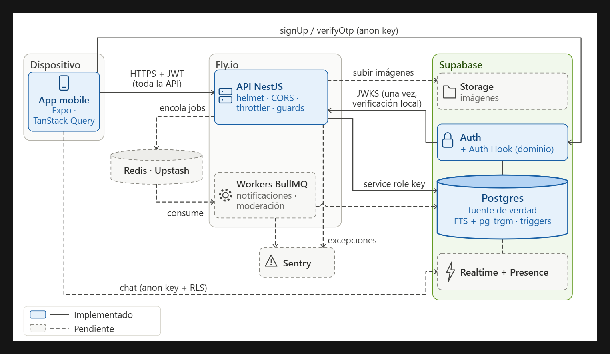

# UTalk — Documentación de arquitectura

UTalk es una red social anónima interuniversitaria: paneles por universidad
más uno general, apodo tipo Reddit (se cambia cada 30 días como máximo), votos, comentarios anidados, chats
directos, y reportes/moderación de contenido.

Esta carpeta documenta las decisiones de **system design** tomadas para el
proyecto: qué tecnología se usa para cada problema, por qué se eligió, y qué
alternativas se descartaron y por qué.

## Índice

- [monorepo.md](./monorepo.md) — estructura del repositorio, npm workspaces, paquete compartido
- [modelo-de-datos.md](./modelo-de-datos.md) — tablas de Supabase, relaciones, y los schemas Zod compartidos que las espejan
- [arquitectura-backend.md](./arquitectura-backend.md) — organización interna de módulos NestJS: hexagonal/Clean Architecture, Entities, comunicación entre módulos
- [mobile.md](./mobile.md) — estructura de la app Expo, navegación, TanStack Query (datos y caché del cliente), errores y variables de entorno
- [backend-y-colas.md](./backend-y-colas.md) — NestJS, hosting, variables de entorno, BullMQ + Redis, notificaciones, moderación y rate limiting
- [datos-y-trending.md](./datos-y-trending.md) — Supabase/Postgres como fuente de verdad, trending (`hot`) como columna generada, contadores por trigger
- [chat-realtime.md](./chat-realtime.md) — chats 1 a 1: se escribe por la API, se lee por Realtime; solicitudes, bloqueo, "Visto" y "escribiendo…"
- [auth.md](./auth.md) — registro y login, verificación local del JWT, universidad por dominio de correo
- [busqueda.md](./busqueda.md) — full-text search + `pg_trgm`, cómo está implementada y por qué no se usa un motor dedicado
- [observabilidad.md](./observabilidad.md) — logging, manejo de errores, monitoreo
- [testing.md](./testing.md) — tests unitarios, fixtures, `npm run check` y CI
- [decisiones-descartadas.md](./decisiones-descartadas.md) — tecnologías evaluadas y por qué no se usan (todavía)

## Resumen del stack

| Capa | Tecnología | Rol |
|---|---|---|
| Monorepo | npm workspaces | Compartir código entre `apps/backend` y `apps/mobile` vía `packages/shared` |
| Cliente | Expo SDK 58 (React Native 0.88) | App móvil |
| Datos en el cliente | TanStack Query | Caché, paginación por cursor y reintentos de los datos de la API en el mobile |
| Backend | NestJS | API HTTP |
| Hosting backend | Fly.io | Proceso persistente 24/7 (necesario para los workers de colas) |
| Base de datos | Supabase (Postgres) | Fuente de verdad de todos los datos |
| Auth | Supabase Auth | Login sin contraseña vía código al correo institucional |
| Tiempo real | Supabase Realtime (`postgres_changes` + Broadcast) | Mensajes del chat, "Visto" y "escribiendo..." |
| Almacenamiento de archivos | Supabase Storage | Imágenes de posts |
| Colas de trabajo | BullMQ | Notificaciones, moderación |
| Backing store de colas / cache | Redis (Upstash, serverless) | Almacenamiento de BullMQ (y del rate limiting cuando el backend tenga más de una instancia) |
| Búsqueda | Postgres full-text search + `pg_trgm` | Buscar posts/comentarios |
| Rate limiting | `@nestjs/throttler` (en memoria; a Redis con más de una instancia) | Anti-spam a nivel de API |
| Observabilidad | Sentry + logs de Fly.io | Detección de errores en producción |
| Tipos compartidos | `packages/shared` (Zod) | Contratos de datos entre backend, mobile, y payloads de jobs |

## Diagrama de arquitectura

Las líneas punteadas y los nodos con borde punteado son piezas **ya
decididas pero todavía no implementadas** (ver la tabla siguiente).

Puntos clave que el diagrama resume:

- **El mobile habla con el backend para casi todo.** Solo va directo a
  Supabase para el registro/verificación de correo (Auth) y para **leer**
  el chat por Realtime (escribir mensajes también va por el backend). Ver
  [auth.md](./auth.md) y [chat-realtime.md](./chat-realtime.md).
- **El backend usa la service role key** (bypassa RLS) y es el único punto
  de control de acceso de las tablas de contenido. Por eso esas tablas
  tienen RLS activo sin políticas. Ver
  [modelo-de-datos.md](./modelo-de-datos.md).
- **El JWT se verifica localmente** con la clave pública (JWKS) de
  Supabase, sin una llamada a Supabase por request.
- **Redis nunca es fuente de verdad**: si se pierde, se reconstruye desde
  Postgres.

### Estado de implementación

| Pieza | Estado | Dónde |
|---|---|---|
| Monorepo + `@utalk/shared` (Zod) | Implementado | [monorepo.md](./monorepo.md) |
| API NestJS: auth, perfiles, universidades, paneles, comunidades, posts, comentarios, votos, reportes, moderación, búsqueda, chat, bloqueos | Implementado | [arquitectura-backend.md](./arquitectura-backend.md) |
| Supabase Auth + Auth Hook por dominio de correo | Implementado | [auth.md](./auth.md) |
| Postgres: contadores por trigger, `hot` generado, soft delete, FTS + `pg_trgm` | Implementado | [datos-y-trending.md](./datos-y-trending.md), [busqueda.md](./busqueda.md) |
| Seguridad de la API: JWT local, rate limiting en memoria, CORS, helmet, Problem Details | Implementado | [auth.md](./auth.md), [backend-y-colas.md](./backend-y-colas.md), [observabilidad.md](./observabilidad.md) |
| App mobile: feeds, detalle, interacción, reportes, búsqueda, comunidades, perfil | Implementado | [mobile.md](./mobile.md) |
| Moderación manual: estado y número de caso de los reportes, cola por comunidad, eliminar o dejar, "Mis reportes" | Implementado | [modelo-de-datos.md](./modelo-de-datos.md#moderación) |
| Tests unitarios + CI (`npm run check`) | Implementado | [testing.md](./testing.md) |
| Chat 1 a 1: solicitudes de mensaje, bloqueo, "Visto" y "escribiendo…" (Realtime + Broadcast) | Implementado | [chat-realtime.md](./chat-realtime.md) |
| Push del chat con la app cerrada | Pendiente | [chat-realtime.md](./chat-realtime.md) |
| BullMQ + Redis (notificaciones, moderación por IA) | Pendiente | [backend-y-colas.md](./backend-y-colas.md) |
| Imágenes en posts (Storage) | Pendiente | — |
| Sentry | Pendiente | [observabilidad.md](./observabilidad.md) |
| Deploy en Fly.io | Pendiente | [backend-y-colas.md](./backend-y-colas.md) |

## Principios de diseño seguidos

1. **No sobre-diseñar.** Cada pieza de infraestructura se agregó porque resolvía
   un problema concreto ya identificado, no una necesidad hipotética futura.
   Ver [decisiones-descartadas.md](./decisiones-descartadas.md) para el
   razonamiento de lo que se dejó afuera (Kafka, microservicios, Turborepo,
   Elasticsearch).
2. **Monorepo modular, no microservicios.** Un solo backend NestJS que
   internamente desacopla trabajo pesado con colas — no un ecosistema de
   servicios independientes.
3. **Postgres es siempre la fuente de verdad.** Cualquier dato en Redis
   (colas, contadores de rate limiting) es una copia derivada, reconstruible
   desde Postgres en cualquier momento.
4. **Lo síncrono nunca espera a lo asíncrono.** Una acción del usuario
   (postear, votar, mandar un mensaje) responde en cuanto su parte esencial
   se completa; el trabajo secundario (notificar, moderar, recalcular
   rankings) se resuelve después, sin bloquear al usuario.
