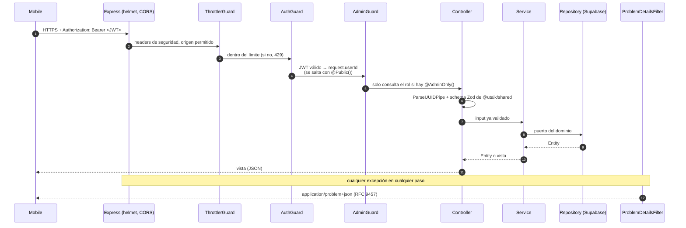

# Arquitectura interna del backend

Cómo se organiza el código dentro de `apps/backend`, a nivel de módulo —
distinto de [backend-y-colas.md](./backend-y-colas.md), que cubre por
qué se eligió cada pieza de infraestructura (NestJS, BullMQ, hosting).
Este documento lista las tecnologías del backend y cubre cómo se
estructuran los archivos y las dependencias entre capas dentro de cada
módulo de dominio.

## Tecnologías del backend

Versiones según `apps/backend/package.json`. El porqué de las elecciones
de infraestructura está en [backend-y-colas.md](./backend-y-colas.md).

### En uso

| Tecnología | Versión | Para qué |
|---|---|---|
| Node.js | 22 (CI) | Runtime. El paquete es ESM (`"type": "module"`, imports con `.js`) |
| TypeScript | 6 | Lenguaje; `module: nodenext` |
| NestJS (`@nestjs/core`, `@nestjs/common`) | 12 | Framework: módulos, inyección de dependencias, controllers, guards, filtros |
| Express (`@nestjs/platform-express`) | — | Servidor HTTP debajo de Nest; el adaptador se pasa explícito en `main.ts` |
| `@nestjs/config` | 12 | Lee las variables de entorno (`ConfigModule` global) |
| `@nestjs/throttler` | 6 | Rate limiting: límite global + límites estrictos por endpoint (`@Throttle`), en memoria |
| helmet | 8 | Cabeceras HTTP de seguridad |
| `@supabase/supabase-js` | 2 | Cliente de Supabase con la service role key: consultas a Postgres, llamadas a Auth y verificación local del JWT (JWKS) |
| Zod | 4 | Validación de body/query en los controllers, con los schemas de `@utalk/shared` |
| `@utalk/shared` | workspace | Schemas y tipos compartidos con el mobile (contrato de la API) |
| rxjs, reflect-metadata | — | Dependencias que exige Nest |

### Desarrollo, tests y calidad

| Tecnología | Para qué |
|---|---|
| Nest CLI (`@nestjs/cli`, `@nestjs/schematics`) | Build y modo watch |
| Jest 30 + ts-jest + `@nestjs/testing` | Tests unitarios (`*.spec.ts`), ver [testing.md](./testing.md) |
| oxlint (+ `oxlint-tsgolint`) | Lint, incluidas reglas que usan los tipos |
| Prettier | Formato |
| GitHub Actions | CI: typecheck, lint, formato y tests (`npm run check`) |

### Servicios externos

| Servicio | Estado | Para qué |
|---|---|---|
| Supabase Postgres | En uso | Fuente de verdad; triggers, columnas generadas, FTS + `pg_trgm`. Migraciones en `supabase/migrations/` |
| Supabase Auth (+ Auth Hook) | En uso | Cuentas, sesiones y emisión de JWT; el hook valida el dominio del correo |
| Fly.io | Pendiente | Hosting del proceso de la API (y de los workers) |
| BullMQ + Redis (Upstash) | Pendiente | Colas de notificaciones y moderación; rate limiting compartido cuando haya más de una instancia |
| Sentry (`@sentry/nestjs`) | Pendiente | Captura de excepciones en producción |
| Supabase Storage | Pendiente | Imágenes de posts |

## Decisión: monolito modular con arquitectura hexagonal / Clean Architecture

El backend es un monolito (no microservicios — ver
[decisiones-descartadas.md](./decisiones-descartadas.md)), pero cada
módulo de dominio se escribe de forma que **pueda extraerse a un
microservicio independiente más adelante sin reescribir su lógica de
negocio** — solo cambiando el adaptador de infraestructura.

Hexagonal (Ports & Adapters, Cockburn) y Clean Architecture (Robert C.
Martin) son, en la práctica, el mismo principio con distinta
nomenclatura: la lógica de negocio no debe depender de detalles técnicos
(Supabase, HTTP, BullMQ) — el dominio define **puertos** (interfaces) y
la infraestructura provee **adaptadores** que los implementan. La regla
que hace esto funcionar (la "Dependency Rule" de Clean Architecture):
**el código de `domain/` nunca importa nada de `infrastructure/`** — la
dirección de dependencia siempre apunta hacia adentro.

## Nivel de rigor elegido: 3 conceptos, no las 4 capas completas

Clean Architecture "de libro" define 4 capas (Entities, Use Cases,
Interface Adapters, Frameworks & Drivers). En la práctica de la
industria, para APIs de este tamaño (no un proyecto enterprise con
equipos grandes), es común colapsar `application/` y `presentation/` en
el `service`/`controller` estándar de Nest, sin perder el desacople real
(que viene de separar `domain/` de `infrastructure/`).

Estructura elegida por módulo:

```
apps/backend/src/modules/<dominio>/
├── domain/
│   ├── <dominio>.entity.ts        # clase con métodos (no un tipo plano)
│   └── <dominio>.repository.ts     # el puerto: interface, sin implementación
├── infrastructure/
│   └── supabase-<dominio>.repository.ts  # el adaptador: implementa el puerto con Supabase
├── <dominio>.service.ts            # casos de uso (equivalente a application/)
├── <dominio>.view.ts               # entidad → lo que sale por la red (schema de @utalk/shared)
├── <dominio>.controller.ts         # rutas HTTP (equivalente a presentation/)
└── <dominio>.module.ts             # cablea todo vía DI de Nest
```

### Dirección de las dependencias dentro de un módulo

El único que conoce al adaptador concreto es el `*.module.ts`: el
service recibe la interfaz vía `@Inject(TOKEN)`, donde `TOKEN` es un
`Symbol` exportado junto al puerto (`POST_REPOSITORY`). Reemplazar
Supabase por otra cosa (o por un repositorio falso en los tests) es
cambiar esa línea, nada más.

**Cuándo partir `<dominio>.service.ts` en varios `*.use-case.ts`
separados** (recién ahí formalizar una carpeta `application/`): cuando
el service acumule muchos métodos con lógica compleja e independiente
entre sí y se vuelva difícil de navegar como un solo archivo — no de
entrada, por dogma.

## Entities: clases con métodos, no tipos planos

Se eligió representar las Entities de dominio (`Post`, `Profile`, etc.)
como clases con comportamiento propio, no como los tipos inferidos de
Zod (`type Post = z.infer<typeof postSchema>`) usados directamente.

```ts
// domain/post.entity.ts
export class PostEntity {
  constructor(
    readonly id: string,
    readonly communityId: string,
    readonly authorId: string,
    readonly title: string,
    readonly body: string,
    readonly score: number,
    readonly commentCount: number,
    readonly createdAt: Date,
  ) {}

  isAuthoredBy(userId: string): boolean {
    return this.authorId === userId;
  }

  isEditableBy(userId: string): boolean {
    return this.isAuthoredBy(userId);
  }
}
```

**Por qué clase y no tipo plano**: reglas de negocio que dependen del
propio dato (ej. "quién puede editar este post", cálculos de
antigüedad para trending) viven en un solo lugar, en vez de reescribirse
en cada sitio del código que las necesite. Elegido conscientemente por
valor de aprendizaje del patrón completo, aunque un tipo plano hubiera
sido suficiente para reglas triviales.

**Distinción con los schemas de `packages/shared`**: los schemas Zod
(`postSchema`, etc.) son el contrato de datos que cruza la red
(backend ↔ mobile) — no tienen métodos, son estructura pura. La Entity
es un concepto interno del backend, nunca cruza la red. El
`infrastructure/supabase-<dominio>.repository.ts` es responsable de
convertir entre la fila cruda de Supabase (snake_case) y una instancia
real de la Entity.

## Vistas: lo que sale por la red

Los controllers **nunca devuelven una Entity**. Nest serializa a JSON
cualquier objeto que devuelva un controller, con todos sus campos: si se
devolviera la Entity, cualquier campo que se le agregue aparecería solo en
la API, sin que nadie lo decida. Así se filtró `profiles.role` en
`GET /profiles/:id` antes de adoptar este patrón.

Cada módulo tiene un `<dominio>.view.ts` con funciones puras que convierten
la Entity al schema de `@utalk/shared` que es el contrato con el cliente
(`toCommunityView(community): Community`). La vista decide explícitamente qué campos
se exponen y adapta el formato (ej. `Date` → string ISO).

**Dónde se arma la vista**:

- **En el controller**, si la Entity ya trae todo lo que la vista muestra
  (comunidades, paneles, universidades, reportes, votos): solo se traduce.
- **En el service**, si armarla requiere consultar o combinar datos que la
  Entity no tiene (posts y comentarios: el autor con su universidad y el
  voto de quien mira; comentarios, además, el árbol de respuestas; perfil
  público: la universidad). El service expone entonces dos métodos: uno
  que devuelve la vista, para el controller (`findViewById`), y otro que
  devuelve la Entity, para otros módulos del backend (`findById`). Las
  vistas van hacia afuera; las Entities se quedan adentro.

**Colecciones**: toda respuesta que es una lista va envuelta en
`{ items: [...] }` (`listSchema` / `List<T>` en shared), aunque hoy no
pagine; las paginadas agregan `nextCursor`. Con un array suelto, agregar
paginación después rompería a los clientes; con el objeto, solo se agrega
un campo.

**Parámetros de ruta**: todo id en la URL se valida con `ParseUUIDPipe`;
un id mal formado responde 400 en vez de llegar a Postgres y terminar en
500.

## Comunicación entre módulos: inyección directa, no eventos genéricos

Cuando un módulo necesita un dato de otro **dentro del mismo request**
(ej. `PostsModule` necesita el `university_id` del autor, que vive en
`ProfilesModule`, para validar en qué comunidades puede postear), la
comunicación es una **llamada directa e inyectada** — el patrón estándar
de Nest (`PostsModule` importa `ProfilesModule`, inyecta
`ProfilesService` en su constructor), no un event emitter genérico
(`@nestjs/event-emitter`) ni una cola.

**Por qué no eventos para este caso**: los eventos genéricos son útiles
cuando el productor no necesita ni debería saber quiénes son todos los
consumidores posibles, típicamente para reacciones opcionales a algo que
ya pasó. El caso de `PostsModule` necesitando el `university_id` del
autor es una **pregunta que necesita respuesta síncrona, ahora, para
poder continuar** — no una notificación fire-and-forget. Forzar eventos
ahí sería complejidad sin beneficio real.

**Por qué esto no compite con BullMQ**: las colas (ver
[backend-y-colas.md](./backend-y-colas.md)) siguen siendo el mecanismo
para lo que ya se definió como asíncrono (notificaciones, moderación,
recálculo de trending) — ahí el productor **sí** nombra la cola
explícitamente (`queue.add('notify-subscribers', ...)`), no es un evento
genérico tampoco. La inyección directa cubre un caso distinto:
comunicación síncrona dentro del mismo request.

**Costo de extraer un módulo a microservicio más adelante**: bajo,
porque la firma del método inyectado (`profilesService.findById(id):
Promise<Profile>`) no cambia — solo cambia qué hay detrás de esa llamada
(de una consulta local a Postgres, a una llamada HTTP/gRPC a otro
servicio). El código que la llama no se entera del cambio.

### Dependencias entre módulos

Cada fila es el `imports: [...]` de su `*.module.ts` (el módulo inyecta el
service de los que lista). Tiene que seguir siendo un **grafo sin
ciclos**: si dos módulos se necesitan mutuamente, es señal de que la
responsabilidad está mal repartida (o de que lo que se busca es una
reacción asíncrona, que va por cola).

| Módulo | Depende de |
|---|---|
| `universities` | — |
| `profiles` | `universities` |
| `panels` | `universities` |
| `auth` | `profiles`, `universities` |
| `communities` | `panels`, `profiles` |
| `posts` | `communities`, `panels`, `profiles` |
| `comments` | `posts`, `profiles` |
| `votes` | `posts`, `comments`, `profiles` |
| `reports` | `posts`, `comments`, `profiles` |
| `moderation` | `communities`, `posts`, `comments`, `profiles` |
| `blocks` | `profiles` |
| `chat` | `profiles`, `blocks` |
| `search` | `panels`, `communities` |

`moderation` es un módulo aparte de `reports`: `reports` crea reportes y
lista los de cada persona; `moderation` tiene la cola y los casos de uso de
quien modera (ver la sección Moderación de
[modelo-de-datos.md](./modelo-de-datos.md#moderación)). Su dominio
(`ModerationCaseEntity`) reutiliza el tipo `ReportTarget` del dominio de
`reports`: un dominio puede importar tipos de otro dominio, nunca de su
`infrastructure/`.

`chat` tiene **dos puertos** en su `domain/` (`ConversationRepository` y
`MessageRepository`, cada uno con su adaptador), porque son dos tablas con
operaciones distintas; el service los usa juntos. `blocks` es un módulo
aparte porque bloquear es una relación entre usuarios, no algo del chat
(mañana puede ocultar también publicaciones). Ver
[chat-realtime.md](./chat-realtime.md).

La tabla está ordenada por capas: cada módulo depende solo de módulos que
aparecen más arriba.

Fuera de la tabla, porque los usa cualquiera:

- **`SupabaseModule`** (`src/supabase/`): `@Global()`, expone
  `SupabaseService` (el cliente con la service role key). Solo lo
  inyectan los adaptadores de `infrastructure/`.
- **`src/common/`**: piezas transversales sin estado de dominio —
  `AppException` + `errorCatalog` (códigos de error), el
  `ProblemDetailsFilter`, la traducción de errores de Postgres
  (`databaseError`), los límites de rate limiting y el parseo de
  `CORS_ORIGINS`.

## Ciclo de vida de un request

Qué atraviesa un request antes y después de llegar al código del módulo
(configurado en `main.ts` y `app.module.ts`):



- **El orden de los guards importa**: el rate limiting va primero para
  frenar también a quien manda tokens inválidos en masa, y `AdminGuard`
  lee el `userId` que deja `AuthGuard`. Los tres son `APP_GUARD` globales:
  toda ruta es privada salvo las marcadas con `@Public()`.
- **`trust proxy`** está activo porque en Fly.io todas las requests llegan
  desde el proxy; sin eso, el rate limiting contaría a todos los usuarios
  como un único cliente.
- **La validación es explícita en el controller** (`schema.parse(body)`),
  no con un `ValidationPipe` global: el schema es el mismo que usa el
  mobile, así que el contrato vive en un solo lugar.
- **La moderación por comunidad no es un guard**: depende de qué comunidad
  se toca, así que la valida el service contra `community_moderators`
  (`CommunitiesService.canModerate()`, que también deja pasar a los admins).
  Por eso los endpoints de `/moderation` no llevan `@AdminOnly()`, que es
  solo para el rol global de admin.
- El formato de error y el catálogo de códigos están en
  [observabilidad.md](./observabilidad.md).

## Ejemplo de flujo completo

Versión simplificada del módulo `posts` real (el código completo está en
`apps/backend/src/modules/posts/`):

```ts
// domain/post.repository.ts — el puerto, y el token con que se inyecta
export interface PostRepository {
  create(post: NewPost): Promise<PostEntity>;
  findById(id: string): Promise<PostEntity | null>;
}
export const POST_REPOSITORY = Symbol('POST_REPOSITORY');

// posts.service.ts — caso de uso, orquesta entity + repository + otros módulos
@Injectable()
export class PostsService {
  constructor(
    @Inject(POST_REPOSITORY) private readonly postRepository: PostRepository,
    private readonly communitiesService: CommunitiesService, // inyección directa
    private readonly panelsService: PanelsService,
    private readonly profilesService: ProfilesService,
  ) {}

  // Devuelve la vista (no la Entity) porque armarla necesita el autor:
  // ver "Dónde se arma la vista" más arriba.
  async create(input: CreatePostInput, authorId: string): Promise<PostView> {
    const [author, community] = await Promise.all([
      this.profilesService.findById(authorId),
      this.communitiesService.findById(input.communityId),
    ]);
    const panel = await this.panelsService.findById(community.panelId);
    if (!panel.acceptsPostsFrom(author.universityId)) {   // regla en la Entity
      throw new AppException('CANNOT_PUBLISH_IN_PANEL', `You cannot post in community ${community.id}`);
    }
    const post = await this.postRepository.create({ ...input, authorId });
    return toPostView(post, author /* ... */);
  }
}

// infrastructure/supabase-post.repository.ts — el adaptador
@Injectable()
export class SupabasePostRepository implements PostRepository {
  constructor(private readonly supabase: SupabaseService) {}

  async create(post: NewPost): Promise<PostEntity> {
    const { data, error } = await this.supabase.client
      .from('posts')
      .insert({ community_id: post.communityId, author_id: post.authorId, title: post.title, body: post.body })
      .select()
      .single();
    if (error) throw new Error(error.message);
    return toEntity(data); // fila snake_case → new PostEntity(...)
  }
}

// posts.controller.ts — valida con el schema compartido y devuelve la vista
@Throttle(STRICT_RATE_LIMITS.createPost) // límite más estricto que el global
@Post()
async create(@Body() body: unknown, @CurrentUserId() userId: string) {
  const input = createPostSchema.parse(body);
  return this.postsService.create(input, userId);
}

// posts.module.ts — cablea el puerto con el adaptador concreto
@Module({
  imports: [CommunitiesModule, PanelsModule, ProfilesModule],
  controllers: [PostsController],
  providers: [PostsService, { provide: POST_REPOSITORY, useClass: SupabasePostRepository }],
  exports: [PostsService],
})
export class PostsModule {}
```
